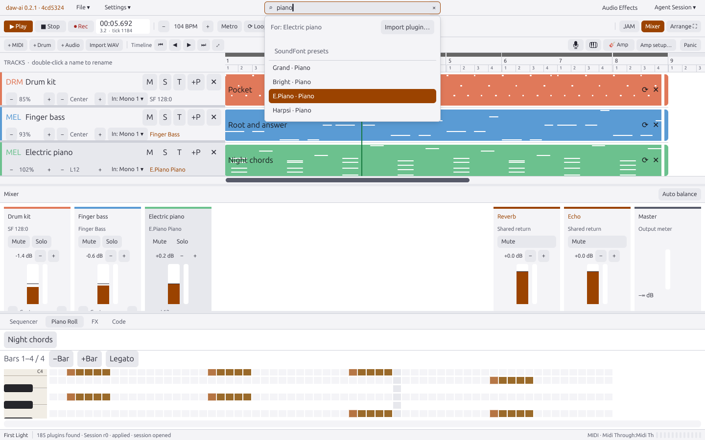

# daw-ai

**The LLM-native DAW.** A full digital audio workstation in Rust — desktop
GUI, terminal UI, and an MCP server that lets AI agents compose, mix, and
*hear* your project. Linux-first.


## Why this exists

Text-to-music models return a finished audio file you cannot edit. MIDI and
notation generators return notes nobody has heard. daw-ai sits in between: a
language model works the way a producer does, on an editable project in a real
audio engine, and it can render and measure its own work before anyone presses
play.

- **Editable, not generated.** A song is a plain-text `.daw.json` file
  ([format](docs/project-format.md)): tracks, patterns, notes, automation and
  mix. A model's work can be read, diffed, versioned and corrected by hand,
  one note at a time.
- **A feedback loop, not a one-shot.** Agents compose through the MCP server,
  render bars with `listen`, check them with `analyze_mix`, `analyze_melody`
  and `check_tracks`, and revise.
- **The musician decides.** In a live session, the musician and the agent edit
  one project with revision checks and shared undo. `prepare_audition` makes
  matched A/B clips to judge by ear. Measurements describe levels and balance;
  they do not decide whether the music is good.
- **A real engine underneath.** Live playback and export share one mixer, with
  CLAP plugins, SoundFont and SFZ instruments, inserts, sends and recording, so
  results hold up outside the experiment.
- **A test bench.** The aim is to measure how well current models compose,
  arrange and mix when they have these tools (see [About](#about-this-project)).

## Quickstart

Building on Linux needs a recent stable Rust and a few system libraries
(Debian/Ubuntu names):

```bash
sudo apt-get install -y libasound2-dev libxkbcommon-x11-dev libwayland-dev \
  libvulkan-dev libxcb1-dev libfontconfig1-dev libssl-dev pkg-config fluid-soundfont-gm
```

From the repository, open **First Light**, an eight-bar demo that uses only
the default General MIDI SoundFont:

```bash
./fetch-assets.sh --quickstart
cargo run --release --locked -- --gui examples/quickstart.daw.json
```

The setup links the distribution's FluidR3 GM SoundFont to `assets/GeneralUser.sf2`
if needed. On other Linux distributions, put a General MIDI `.sf2` file at that
location. Press **Space** to play the demo.

If you hear silence, run `cargo run --release --locked -- doctor examples/quickstart.daw.json`
to check the project, SoundFont, output configuration, MIDI inputs and CLAP paths.
Use `doctor --headless` to skip hardware checks. For a render without audio hardware,
run `cargo run --release --locked -- examples/quickstart.daw.json --export-wav first-light.wav`.

`ffmpeg` is optional (needed for MP3 export); Surge XT is optional
(sound design from words through the MCP server).

- GNOME/Wayland: use `./run-gui.sh` for a normal resizable window
  on systems that need XWayland. Native Wayland also has client window controls.
- Terminal UI: `cargo run --release --locked -- examples/quickstart.daw.json` ([TUI guide](docs/tui.md)).
- See [Examples](examples/README.md) for the longer, sample-based MCP demo.

## Basic workflow

One session with an AI agent, from an empty idea to an exported file.

1. **Open a project in the desktop app.**

   ```bash
   cargo run --release --locked -- --gui examples/quickstart.daw.json
   ```

2. **Connect your agent.** Build the MCP server, then choose
   **Agent Session → Copy MCP configuration** and add it to your MCP client.
   In this repository, `.mcp.json` already registers it for Claude Code. See
   [live collaboration](docs/live-collaboration.md) for details.

   ```bash
   cargo build -p daw-mcp
   ```

3. **Ask for music in plain words.**

   > *"Add an 8-bar bass line under the drums in F minor, keep it sparse.
   > Then listen to bars 0–8 and fix whatever is wrong with the mix."*

4. **The agent works in a loop.** A typical round:
   - reads the song with `project_summary`;
   - writes notes and beats with `set_notes`, `set_steps` or `apply_mini_notation`;
   - renders the bars with `listen` and checks levels with `analyze_mix`;
   - adjusts the mix with `set_track`, `set_effects` or `auto_balance`;
   - makes A/B clips for you with `prepare_audition`.

   Each edit shows up in the open app at once.

5. **You listen and steer.** Press **Space** to play. Tell the agent what to
   change, in your own words. **Ctrl+Z** undoes the agent's last edit as well
   as yours.

6. **Export the result.** Use **Export WAV** or **Export MP3** in the app, or
   render from the command line:

   ```bash
   cargo run --release --locked -- examples/quickstart.daw.json --export-wav song.wav
   ```

Without the desktop app, point the server at a file instead
(`cargo run -p daw-mcp -- my-song.daw.json`); the agent then edits and renders
that file directly.

## Desktop workspace

Click the bar or beat ruler to place the playhead exactly where playback should
start. Use the **Timeline** controls to scroll to the start or end of the song,
or move the view four bars at a time. Hold **Ctrl** while scrolling to zoom around
the pointer.

Open **Mixer** to show channel strips below the arrangement. Edit notes in the
**Piano Roll** or **Sequencer**, and adjust **Swing**, **Humanize**, and **Timing**
in **FX**. Drag the panel dividers to resize them, or choose **Arrange ⛶** for more
timeline space.

Use the microphone and keyboard icons beside **Amp setup** to configure your
audio input and MIDI controller. Switch between **Dark** and **White** in
**Settings → Appearance**.

Hover over **Browse instruments…** or press **Ctrl+K** to search SoundFont and
CLAP instruments for the selected track.



### Import a Flow Music plugin

For an instrument, open **Browse instruments… → Import plugin…** and pick a
Google Flow Music `.fmx` export. Find it under **Flow Music** and click it twice
to confirm replacing the selected melodic track's instrument.

For an effect, select the track and use **Audio Effects → Add effect → Import plugin…**.
Click **Add** next to the imported effect to insert it. Effects process audio
clips and instrument tracks during playback and export.

To hear a microphone through those effects live, choose its device and channel
under **In: …** on an audio track, then click **Monitor** on the same track.
Monitoring also arms the track. **Rec** starts the take using the chosen recording
source. Click **Monitor** again to turn it off while keeping the track armed.

Choose **Open editor** in the **FX** pane to open the original panel in a new
browser window. Parameter changes are saved with the project. The browser editor
uses Python 3 and a browser with new-window support, such as Chrome or Firefox.

Imported plugins are available to future projects from the local library
at `~/.local/share/daw-ai/flow-plugins` (or under `$XDG_DATA_HOME` when set).
You can also install an instrument with

```bash
cargo run -- --import-plugin /path/to/plugin.fmx
```

The importer supports compatible Flow Music ABI 1 instruments and stereo effects.
Native VST2/VST3 binaries require separate host support.

## Features

| Area | Today |
|---|---|
| **Sequencing** | Time signatures from 1/2 to 16/16 (3/4, 5/4, 7/4, 6/8 …), stepped or ramped tempo changes, 16th-note step grid with per-step velocity, piano roll with drag-stretch legato, pitch bends and CC curves, per-pattern swing, Strudel-style mini-notation REPL, arrangement timeline with clip previews and per-clip gain, loop region |
| **Mixing** | Docked mixer with channel strips, EQ/comp/delay/drive/filter, shaped reverb, synced stereo echoes, sends, editable volume-automation lanes, live meters, master limiter and auto-balance |
| **Recording** | Transport-synced takes with count-in, punch-in/out, loop-cycle takes (one WAV per pass), MIDI recording into patterns, input metering with clip latch |
| **Plugins** | CLAP hosting: instruments and insert effects, plugin discovery, generic param editing, state saved in the project |
| **AI** | MCP server (about 75 tools), JSON project format, live shared sessions, JAM hot-reload, listening and analysis tools (mix, melody, groove, arrangement), auditions, auto-balance, track comments the agent can read |
| **Guitar** | Low-latency live amp rig (gate, boost, amp, modeled cabinets with A/B blend, pedals), custom cabinet IRs, presets, recording dry or through the rig, optional AmpForge CLAP backend ([guide](docs/guitar-amp.md)) |
| **I/O** | GM soundfonts (per-track `.sf2`), SFZ multi-sampled instruments, velocity-layered samplers with alternate takes, audio clips, MIDI input, WAV and MP3 export |

## Architecture

| Crate | Role |
|---|---|
| `daw-core` | Engine, mixer graph, sequencer, project format, analysis — no UI dependencies |
| `daw-io` | Host glue: audio/MIDI device handling, capture, guitar monitor, user config, the engine relay |
| `daw-gpui` | Desktop GUI (gpui) |
| `daw-tui` | Terminal UI (ratatui) |
| `daw-mcp` | MCP server over a selected live session or project file (rmcp, stdio) |

Every feature was built spec-first — designed, planned, then implemented
and verified one slice at a time.

## Docs

- [Terminal UI guide & keybindings](docs/tui.md)
- [The `.daw.json` project format](docs/project-format.md)
- [Desktop UI and Mixing](docs/desktop-ui.md)
- [Live collaboration, safe saves and background rendering](docs/live-collaboration.md)
- [Creative effects and CLAP controls](docs/creative-effects.md)
- [MP3 export](docs/mp3-export.md)
- [Listening and analysis tools](docs/analysis-and-ci.md)
- [Musical collaboration workflow](docs/music-collaboration.md)
- [Guitar amp and low-latency monitoring](docs/guitar-amp.md)
- [Audio engine audit](docs/audio-engine-audit.md) · [Desktop UI review](docs/ui-review.md)
- [CLAUDE.md](CLAUDE.md) — working on the codebase (with an AI or without)

## License

MIT OR Apache-2.0, at your option. The GeneralUser GS soundfont and
fetched samples carry their own free licenses — see `fetch-assets.sh`.

---

## About this project

daw-ai is an experimental research project. It serves as a test bench for
measuring how well current state-of-the-art language models can compose,
arrange and mix music when given a real audio engine and an audio feedback
loop (the `listen` tool).

Contact: nazariihrubiian@gmail.com

## Verification

Run `bash scripts/check.sh` for the Linux build, MCP protocol checks, workspace
tests and Clippy. Set `DAW_REQUIRE_TEST_ASSETS=1` when the test soundfont is
installed. After building, `python3 scripts/test-quickstart.py` runs the clean
demo smoke test with the system FluidR3 GM package and FFmpeg. MP3 integration
tests require FFmpeg with libmp3lame. Hardware tests
remain explicit; headless checks do not certify every audio device or plugin.
See [CLAUDE.md](CLAUDE.md) for the crate layout and conventions. Issues and
pull requests are welcome.
