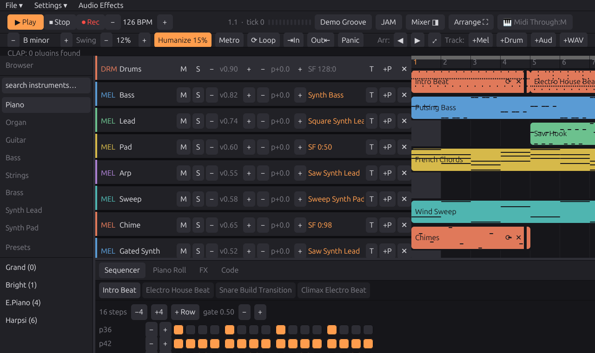

# daw-ai

**The LLM-native DAW.** A full digital audio workstation in Rust — desktop
GUI, terminal UI, and an MCP server that lets AI agents compose, mix, and
*hear* your project. Linux-first.




## Why this exists

- **The project file is the API.** Songs are human-readable `.daw.json`
  ([format docs](docs/project-format.md)); a local shared session lets a musician
  and an LLM edit with revision checks and shared undo. File-based MCP and conflict-checked JAM import remain
  available for offline work.
- **Agents can hear.** The bundled MCP server exposes ~30 tools: compose
  (drum grids, mini-notation melodies, arrangement), mix (faders, sends,
  CLAP plugins, auto-balance) — and `listen`, which renders any bar range
  and reports peak/RMS, per-bar loudness, stereo width, and 7-band
  spectral balance. A feedback loop, not just a control surface.
- **It's a real DAW.** Per-track mixer with insert FX, reverb/delay send
  buses and live meters; CLAP plugin hosting (instruments and effects);
  transport-synced audio recording with count-in and loop/punch takes;
  a piano roll with multi-bar legato; WAV and MP3 export through the shared
  mixer. Scheduling, device/plugin settings and normalization can affect
  live/offline results.

## Quickstart

```bash
git clone https://github.com/hrubiian/daw-ai.git && cd daw-ai
./fetch-assets.sh                                    # free soundfont + samples (CC0/MIT)
cargo run --release -- --gui examples/demo.daw.json  # desktop GUI
```

- GNOME/Wayland: use `./run-gui.sh` for a normal resizable window
  on systems that need XWayland. Native Wayland also has client window controls.
- Terminal UI instead: `cargo run --release` ([TUI guide](docs/tui.md)).
- The example song was composed entirely by an LLM through the MCP server.

## Compose with Claude

```bash
cargo build -p daw-mcp     # .mcp.json already registers it for Claude Code
```

Open the same project in the GUI with JAM mode on, then ask your agent:

> *"Write a 124 bpm house groove, 8 bars. Then listen to bars 0–8 and fix
> whatever's wrong with the mix."*

The agent edits the project file through granular tools (every mutation
returns a fresh project summary), the GUI follows live, `auto_balance`
levels the tracks by measured loudness, and `listen` tells it what the
render actually sounds like — numbers it can act on.

For direct live-session editing, [discover and select the running session](docs/live-collaboration.md).
A disconnected agent reports an error instead of falling back to file replacement.

## Features

| Area | Today |
|---|---|
| **Sequencing** | 16th-note step grid with per-step velocity, piano roll with drag-stretch legato across bars, Strudel-style mini-notation REPL, arrangement timeline with clip content previews, loop region |
| **Mixing** | Dedicated Mixing workspace, EQ/comp/delay/drive/filter, shaped reverb, synced stereo echoes, sends, live meters, master limiter and auto-balance |
| **Recording** | Transport-synced takes with count-in, punch-in/out, loop-cycle takes (one WAV per pass), MIDI recording into patterns, input metering with clip latch |
| **Plugins** | CLAP hosting: instruments and insert effects, plugin discovery, generic param editing, state saved in the project |
| **AI** | MCP server (~30 tools), JSON project format, JAM hot-reload, listening/analysis tools, auto-balance |
| **I/O** | GM soundfonts (per-track `.sf2`), velocity-layered samplers with alternate takes, audio clips, MIDI input, WAV and MP3 export |

## Architecture

| Crate | Role |
|---|---|
| `daw-core` | Engine, mixer graph, sequencer, project format, analysis — no UI dependencies |
| `daw-io` | Host glue: audio/MIDI device handling, capture, the engine relay |
| `daw-gpui` | Desktop GUI (gpui) |
| `daw-tui` | Terminal UI (ratatui) |
| `daw-mcp` | MCP server over a selected live session or project file (rmcp, stdio) |

Every feature was built spec-first — designed, planned, then implemented
and verified one slice at a time.

## Docs

- [Terminal UI guide & keybindings](docs/tui.md)
- [The `.daw.json` project format](docs/project-format.md)
- [Desktop UI and Mixing](docs/desktop-ui.md)
- [Live collaboration, safe saves and background rendering](docs/live-collaboration.md)
- [Creative effects and CLAP controls](docs/creative-effects.md)
- [MP3 export](docs/mp3-export.md)
- [Listening and analysis tools](docs/analysis-and-ci.md)
- [Musical collaboration workflow](docs/music-collaboration.md)
- [Reusable composer skill](skills/bonobo-composer/SKILL.md)
- [CLAUDE.md](CLAUDE.md) — working on the codebase (with an AI or without)

## Roadmap

Automation lanes · piano-roll velocity/CC editing · take comping ·
time-stretch · richer expression/articulation editing · DAWproject
export · de-click micro-fades.

## License

MIT OR Apache-2.0, at your option. The GeneralUser GS soundfont and
fetched samples carry their own free licenses — see `fetch-assets.sh`.

---

## P.S. — status

**daw-ai is an experimental project, currently in beta testing.** It is
**not** intended for serious music production. Its real purpose is a test
bench: to measure how well current state-of-the-art LLMs can compose,
arrange, and mix music when handed a real audio engine and a feedback loop
(`listen`). The DAW is the instrument, the model is the musician, and this
repo is the experiment. Expect rough edges, breaking changes, and bugs —
and feel free to share what your model makes.

**Ideas are very welcome.** If you have a feature, a direction, or just
want to talk about where this could go, open an issue or get in touch with
the developer: **nazariihrubiian@gmail.com**.

## Verification

Run `bash scripts/check.sh` for the Linux build, MCP protocol checks, workspace
tests and Clippy. Set `DAW_REQUIRE_TEST_ASSETS=1` when the test soundfont is
installed. MP3 integration tests require FFmpeg with libmp3lame. Hardware tests
remain explicit; headless checks do not certify every audio device or plugin.
